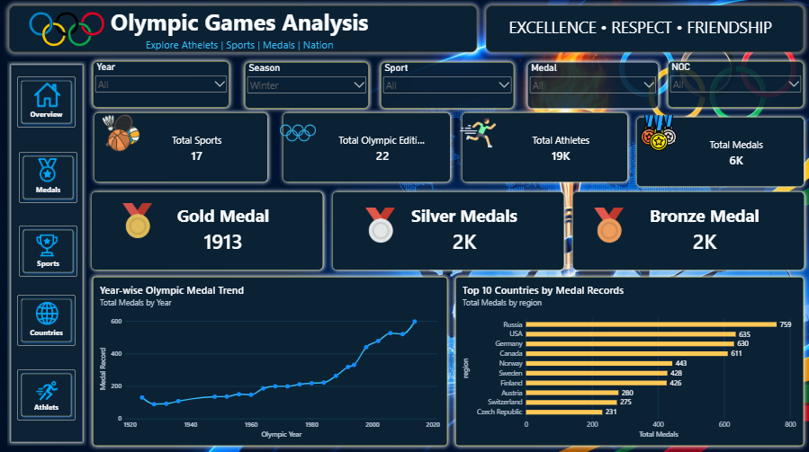
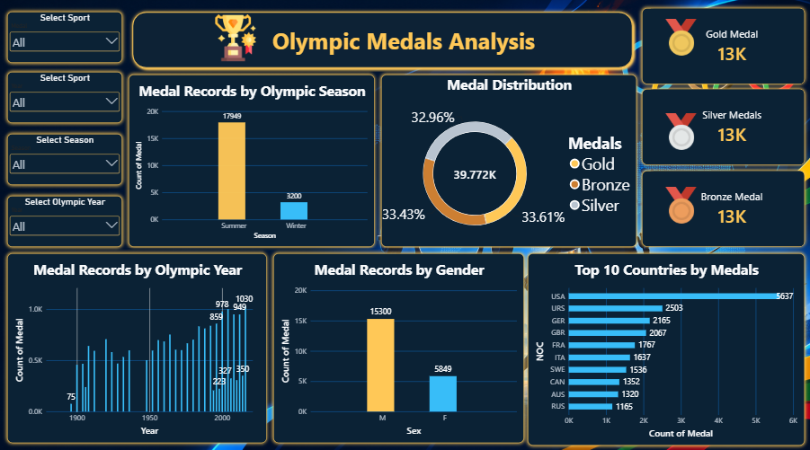
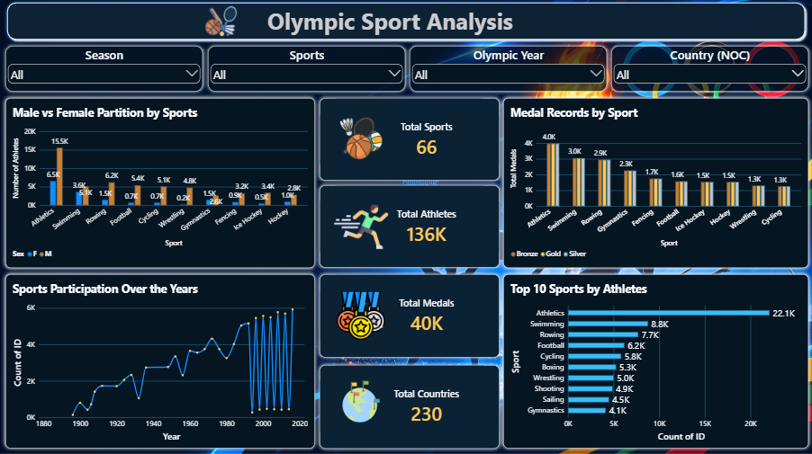
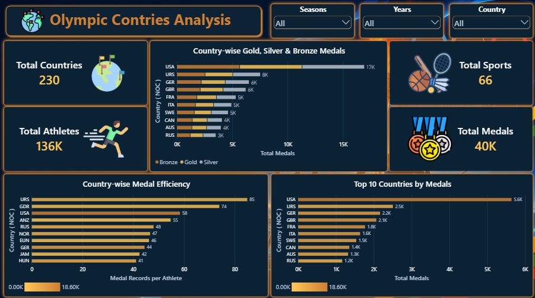
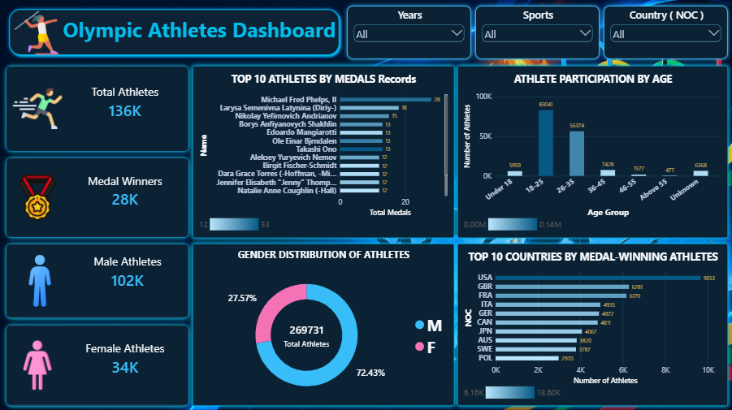

# 🏅 Olympic Games Analytics | Power BI Dashboard

## Project Overview
An interactive Olympic Games Analytics project developed using Microsoft Power BI. This project contains five report pages to explore Olympic data and discover insights about athletes, medals, sports, and countries.

## Dashboard Pages

### 1. Olympic Overview
- Total Sports, Olympic Editions, Athletes and Medals
- Year-wise Olympic Medal Trends
- Top 10 Countries by Medal Records

### 2. Medals Analysis
- Gold, Silver and Bronze Medal Analysis
- Medal distribution and comparisons

### 3. Sports Analysis
- Sports participation analysis
- Athlete participation across sports

### 4. Countries Analysis
- Country-wise Olympic performance
- Country-wise medal analysis

### 5. Athletes Analysis
- Total and medal-winning athletes
- Male and female athlete distribution
- Age group analysis
- Top 10 athletes by medals

## Tools & Technologies
- Microsoft Power BI
- DAX
- Data Visualization
- Interactive Slicers and Filters

## Project File
`Olympic dataset dashboard.pbix`

## Objective
To analyze Olympic Games data and present meaningful insights through interactive Power BI dashboards.

## Author
Bhushan Jadhao

---

## Dashboard Previews

### 1. Olympic Overview

### 2. Medals Analysis

### 3. Sports Analysis

### 4. Countries Analysis

### 5. Athletes Analysis

